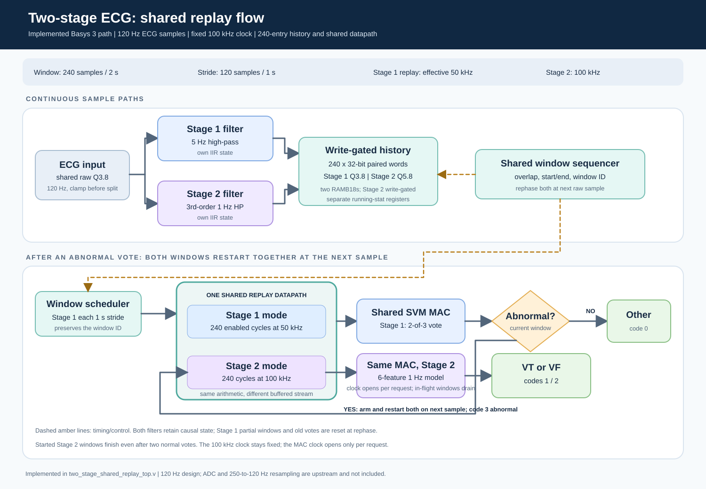

# Combined 120 Hz ECG hardware

An additional whole-pipeline adaptive-clock experiment is now available:
500 Hz while Stage 2 sleeps, 100 kHz while it is armed or draining, then
back to 500 Hz. The input remains 120 Hz and a one-entry handshake preserves
samples during transitions. The original fixed-clock project below remains
the baseline. See [adaptive experiment and test results](adaptive_clock_test/README.md)
and open [the adaptive Vivado project](vivado_adaptive_project/two_stage_adaptive.xpr).
Default Stage 1 replay still takes 480 cycles (0.96 s at 500 Hz).

The Basys 3 default now implements the `hw_shared_pipeline` Stage 2 candidate
with one fixed 100 kHz processing clock. Stage 1 replay advances on alternate
cycles (50,000 samples/s); Stage 2 replay advances every cycle (100,000
samples/s) when requested. Setting `SHARED_HP1_MODEL=0` on the board and
pipeline tops retains the previous 1 kHz, 512-entry reference implementation.
Setting `SHARED_HP1_MODEL=1, DEEP_HISTORY=1` instead keeps the candidate's
same 1 Hz Stage 2 filter and shared classifier but uses a 512-entry history
at 1 kHz for the matched area/power comparison.
The external input is one signed Q16.16 ECG
sample plus a one-cycle `sample_valid` strobe at 120 Hz. Every 240 samples
produce a 2 s window; consecutive windows start 120 samples apart. The
outputs are `Other=0`, `VT=1`, `VF-family=2`, and `Stage 1 abnormal=3`,
tagged by a zero-based completed-window ID. `class_is_stage2` identifies
whether a result came from Stage 2; Stage 1 and Stage 2 may emit separate
results for the same aligned window ID. There is no live ADC, SD reader,
or 250-to-120 Hz resampler in this
package; those are upstream of the defined input boundary.

## Architecture



- The active Basys 3 implementation is `two_stage_shared_replay_top` with
  `SHARED_HP1_MODEL=1`. Stage 1
  uses the copied 5 Hz high-pass. Its old FP16 IP path is retained under
  `stage1_hdl/` for provenance but **not built**. The active classifier uses
  the saved Stage 1 folded coefficients in Q8.24 and a Q40 score. The
  selected 2-of-3 rule is unchanged.
- Stage 2 runs a separate causal third-order 1 Hz high-pass. Its coefficients
  are rounded to Q2.29 and its output is Q5.8. The all-data six-feature
  Q3.12 classifier export in `hw_shared_pipeline/stage2/results/` is used;
  Stage 1 keeps its deployed 5 Hz filter and 2-of-3 gate. The shared replay
  datapath computes features for either stage and a single sequential MAC
  scores both models. One sequencer controls both overlapping streams.
  The candidate has a 240 x 32-bit logical history with independently
  write-enabled 16-bit lanes for Stage 1 and Stage 2. Vivado maps the lanes
  to **two RAMB18s**. Stage 2's lane writes only while a started Stage 2
  window is collecting; stored windows remain readable until replay finishes.
  Stage 1's lane continues writing. Stage 1 replay takes 480 clocks (4.8 ms)
  and Stage 2 replay takes 240 clocks (2.4 ms). The oldest sample is read by
  Stage 2 before the next nominal 120 Hz sample, 8.33 ms later. This depends
  on the 120 Hz sample-arrival contract; bursts require a deeper buffer.
- The 100 kHz processing clock is fixed; Stage 1 uses a half-rate clock
  enable. The shared classifier MAC uses a Xilinx `BUFGCE`, open for either
  stage's scoring request. A second `BUFGCE` closes the Stage 2 window-
  statistics clock outside armed/started windows. `CLOCK_GATING=0` opens
  both clocks for a controlled ablation; Stage 2 RAM write enable is kept
  identical. Stage 2's causal filter always processes every
  input sample to preserve its IIR state;
  its window statistics start only for armed windows. An abnormal 2-of-3
  sequence decision arms Stage 2 and rephases the **shared sequencer** so
  both Stage 1 and Stage 2 begin a new 240-sample window on the first raw
  input sample accepted after that decision. The raw sample index is tracked
  through the filter latency, so this is not merely the next filtered output.
  Partial Stage 1 windows are discarded at rephase. Its 2-of-3 vote history
  is cleared because pre- and post-rephase windows are not consecutive; it
  needs three new completed windows before another sequence decision.
  Thereafter both paths use 120-sample strides. Stage 1 emits code 3 on
  abnormal sequence decisions and code 0 on normal ones. Code 3 is an
  episode-level abnormal indication, not a promise of a later subtype for
  that same triggering window. Stage 2 emits VT/VF
  results for every window started while armed. Two consecutive normal
  sequence decisions stop **new** Stage 2 windows, but already-started
  windows finish and report with their original window IDs. One normal
  decision does not disarm. The controller has one pending slot per stage
  and raises a sticky overflow on stale/duplicate work.
- The Basys 3 demo wrapper uses a synthetic 120 Hz, 12-bit Q3.8 BRAM waveform
  and sign-extends it to Q16.16. It is a board smoke test, not a validation
  source for the full-precision 120 Hz input contract. The smoke test sees
  three Stage 1 reports and four Stage 2 reports. `led[13]` indicates the
  Stage 1 abnormal code; `led[14]` identifies a latest Stage 2 result.

An optional `STAGE1_FULL_RATE=1` experiment removes the Stage 1 half-rate
enable. Reference-vector RTL tests and core-only 100 kHz routed timing passed;
Stage 1 nominal replay becomes 240 rather than 480 clocks. The default is
still `0`. Detailed results are in
`final_two_stage_240_power_design/stage1_full_rate_test/README.md`.

## Reproduce verification

The persistent Vivado 2020.2 project is
[`vivado_project/two_stage_basys3.xpr`](vivado_project/two_stage_basys3.xpr).
Open that file in Vivado for the Basys 3 `xc7a35tcpg236-1` top-level design.
It references RTL, the demo `.mem`, and the XDC in this package by relative
paths; generated project caches and run outputs are ignored by Git. To
recreate or refresh the project from any working directory, run:

```powershell
& 'C:\Xilinx\Vivado\2020.2\bin\vivado.bat' -mode batch -source final_two_stage_design\hardware\scripts\create_vivado_project.tcl -nojournal -nolog
```

The same script with `-tclargs verify` performs a direct synthesis in the
project context; the 1 Hz candidate used 5,268 synthesis LUTs, 2,366
registers, 48 DSPs, and two RAMB18s. On this locked-down Windows environment, Vivado's
project-managed `launch_runs` wrapper could not start because Windows Script
Host returned an access-denied error; no GUI-run status or bitstream is
claimed from that attempt. The separate routed build below used the same
top-level RTL and constraints.

Requirements: Python with NumPy/SciPy/WFDB, ModelSim `vlog`/`vsim` on PATH,
MATLAB R2024b with Fixed-Point Designer, and Vivado 2020.2 for FPGA builds.
From the repository root:

```powershell
powershell -NoProfile -ExecutionPolicy Bypass -File final_two_stage_design\hardware\scripts\run_tests.ps1
python final_two_stage_design\hardware\reference\validate_fixed_stage2.py --shared-frontend
python final_two_stage_design\hardware\reference\validate_shared_hp1_holdout.py
python final_two_stage_design\hardware\reference\validate_shared_hp1_holdout.py --all-records
python final_two_stage_design\hardware\reference\validate_fixed_stage1.py
matlab -batch "addpath('final_two_stage_design/hardware/reference'); verify_fixed_reference_matlab(fullfile(tempdir,'ecg_two_stage_vectors'))"
& 'C:\Xilinx\Vivado\2020.2\bin\vivado.bat' -mode batch -source final_two_stage_design\hardware\scripts\implement_two_stage.tcl -nojournal -nolog
```

The Python integer references are authoritative for exact RTL comparisons;
MATLAB independently checks the old Stage 2 path. The candidate holdout
script compares the new Q2.29 filter and shared-engine features with the
saved all-data Stage 2 export on the four held-out records. Floating-point
training models are a separate accuracy comparison, not bit-exact targets.

Verification completed on this revision:

- ModelSim: exact match for 600 Stage 2 filter samples and four full feature
  windows; four classifier scores; 1,200 Stage 1 filter samples, nine scores,
  and seven combined classes on the older parallel path. The shared path
  checks every Stage 1 score and every triggered Stage 2 feature set/score
  against all-possible-start-sample Python vectors. The 3,600-sample
  reactivation scenario checks 26 Stage 1 scores, 17 Stage 2 scores, two
  independent arms, first-post-trigger-sample alignment, and in-flight drain.
  A separate 600-sample high-amplitude stress
  waveform also matches; both Stage 2 waveforms repeat after reset. The full
  waveform exercises gate opening and
  closing after two normal results. The synthetic BRAM board source produces
  three Stage 1 and four Stage 2 results. No overflow was observed.
- New 1 Hz candidate: bit-exact ModelSim/Python checks cover the Q2.29 filter,
  six shared features, both scores from the same gated MAC, trigger alignment,
  240-entry wraparound, a half-sample-phase offset, and a 3,600-sample
  reactivation sequence. That sequence has 27 Stage 1 scores, 16 Stage 2
  scores, two arms, and two in-flight results drained after disarming.
- The independent four-record holdout model, evaluated with hardware-fixed
  filter and feature arithmetic, has 0 decision changes among 204 windows and
  accuracy 0.960784. Eight windows differ from the floating-point export by
  one Q8 step of line length. The board uses the **all-data** classifier
  weights; those four records are included in that model's training, so its
  accuracy on them is not an independent held-out estimate. The published
  leave-one-record-out candidate result is 0.858. Across all 5,541 windows
  from 38 records, the hardware-fixed filter/features with each record's
  independent LORO weights score **0.858148** accuracy. The all-data model
  has **zero prediction changes** against its fixed-point export on those
  windows. These are Stage 2 window-level checks; the rephased hardware
  gating policy has not been rerun end-to-end on that whole cohort.
- MATLAB: exact Stage 2 filter/features/scores on the 600-sample vectors.
- Previous Stage 2 shared-front-end held-out set: **0 decision changes among 204
  windows**; fixed-point accuracy **0.950980**. Numeric features differ from
  the float shared-front-end in 184 rows, so the exact target is the
  fixed-point reference. This is a Stage 2 model check, not a clinical
  measurement of the trigger-aligned system latency.
- Stage 1 saved-model test records: **11 base-decision changes among 33,169
  windows** under fixed filtering/classifier arithmetic. This small drift
  must be included when reporting system-level clinical metrics. The new
  trigger-aligned rephasing and vote-history reset have **not** yet been
  evaluated on held-out ECG records as an end-to-end detection policy.
- The previous Basys 3 XC7A35T placed-and-routed version meets
  all timing constraints (setup WNS 6.330 ns, hold WHS 0.013 ns). See the resource
  history below. This is not a power measurement or an on-board functional
  test. Vivado still reports `REQP-1840` warnings for asynchronous-reset
  controls on the inferred BRAM; reset-time memory behavior needs review
  before production use.
- The final 1 Hz candidate also placed and routed on XC7A35T: 5,155 LUTs,
  2,368 registers, 48 DSPs, and two RAMB18s. The 100 MHz board clock has
  setup WNS 7.493 ns; the 100 kHz processing clock has setup WNS
  9,937.053 ns and hold WHS 0.015 ns. The longest routed processing-clock
  setup path is about 62.947 ns, a path-delay estimate of about 15.9 MHz;
  this is **not** a re-constrained, re-routed maximum-frequency sign-off.
  The chosen operating clock remains 100 kHz. The same `REQP-1840`
  asynchronous BRAM-control warnings persist.

## Resource history

All numbers below are routed utilization on Basys 3 XC7A35T, not synthesis
estimates. The combined designs include the synthetic board demo source.

| Architecture checkpoint | LUTs / 20,800 | Registers / 41,600 | DSPs / 90 | RAMB18 |
| --- | ---: | ---: | ---: | ---: |
| Stage 1 only, before combined parallel design | Not measured comparably | - | - | - |
| Previous parallel Stage 1 + Stage 2, 500 Hz | 14,205 | 16,128 | 76 | - |
| Shared replay with two separate histories | 11,277 | 16,217 | 76 | - |
| Shared replay, one RAM, before deferred activation | 6,960 | 2,594 | 76 | 1 |
| Deferred one-RAM replay with `w+3` activation | 6,998 | 2,630 | 76 | 1 |
| Previous one-RAM, next-sample aligned replay | 6,947 | 2,817 | 76 | 1 |
| 1 Hz shared-engine/shared-MAC, 240-entry gated Stage 2 lane | 5,155 | 2,368 | 48 | 2 |

The previous one-RAM design used **7,258 fewer LUTs (51.1%)** than the earlier
parallel combined build. The candidate adds independently write-enabled
Stage 2 storage and a simpler filter/shared classifier MAC. The builds have
different clock
architectures, so this table does not establish a power saving. At 100 kHz,
the global clock also switches 100 times faster than in the previous 1 kHz
mode; a power estimate or measurement is still required. The
Stage-1-only baseline is deliberately left unknown rather than inferred from
the combined reports. Build procedure: `scripts/implement_two_stage.tcl`;
the active board top now selects the 1 Hz candidate.

## Matched history-depth and clock comparison

`scripts/report_clock_buffer_tradeoff.tcl` builds the same Stage 1 and
Stage 2 model in two configurations: `-tclargs 0` selects 512 entries at
1 kHz, and `-tclargs 1` selects 240 entries at 100 kHz. The routed
utilization, timing, and Vivado vectorless power reports are in
`power_comparison/`. The 512-entry version uses 5,138 LUTs and 2,360
registers; the 240-entry default uses 5,155 LUTs and 2,368 registers.
Both use 48 DSP48E1s and two RAMB18E1s. Vivado reports 0.079 W total,
0.007 W dynamic, and 0.072 W static for each, rounded to 0.001 W with
low confidence. There is no demonstrated power winner at that precision.
See `Documents/two_stage_clock_buffer_area_power_tradeoff.md` for the
paper wording and the important trigger-timing caveat.

## Idle clock-gating power example

The 240-entry core was routed with `CLOCK_GATING=1` and `0`, using the same
20 s mostly normal synthetic input and its 21 s SAIF activity trace.
The paired simulation produced identical outputs, including 17 normal
Stage 1 sequence results and no Stage 2 wake-up. The gated Stage 2
statistics clock was disabled throughout; the shared classifier clock
opened for 114 of 2,100,001 processing cycles. With the RAM write policy
held fixed, both routed variants use two RAMB18E1s, 48 DSP48E1s, and
2,318 registers; the gated variant uses 4,875 LUTs and always-on uses
4,874. Vivado prints 0.070 W on-chip total and 0.000 W dynamic for both
at 0.001 W resolution. This does not establish zero dynamic power or a
numeric power-saving percentage. See
`Documents/two_stage_idle_clock_gating_power.md` for the SAIF-match and
clock-analysis limitations, and `power_comparison/` for the reports.

The original copied `stage2_classifier_legacy/` is deliberately excluded
from builds: its weights belong to an older model and its input format does
not enforce the v3 feature contract. No database records are copied here.
